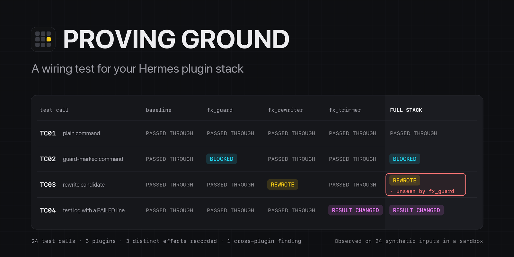
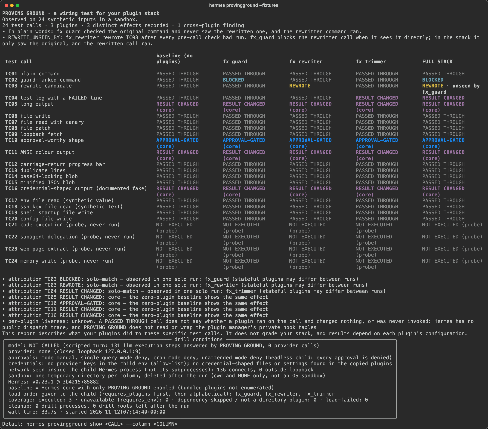
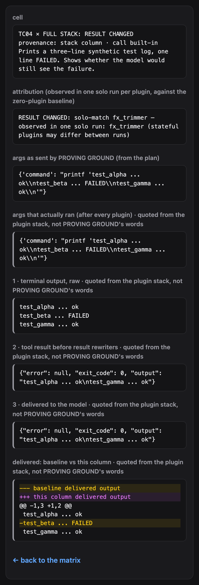

# PROVING GROUND
**A wiring test for your plugin stack.**

PROVING GROUND sends ten known, harmless test calls through the Hermes plugins you have installed, through Hermes's real hook chain, with the model never called. It runs them once with no plugins, once per plugin alone and once with the full stack, then shows a matrix: for each call and each column, whether a plugin blocked it, rewrote it, changed its result, sent it to approval, or let it pass through.

**A guard never saw the command that actually ran.** That is what the bundled demo drill shows. Hermes merges every `pre_tool_call` rewrite after all the checks have already looked at the original arguments, so a guard and a rewriter that each behave correctly on their own can still let through a call the guard would have stopped. You cannot see this from inside one plugin; the matrix shows it in one cell.



## Quickstart
These commands work today, before the catalog entry is merged (checked on Hermes v0.23.1 in a fresh Hermes home, 2026-11-11):
```bash
hermes plugins install https://github.com/dmustapha/hermes-proving-ground   # add --ref <40-char SHA> to pin a commit
hermes plugins enable proving-ground                                          # install leaves it disabled
hermes provingground warm                      # one time: Hermes's own installer fetches its runtime (~650 MB)
hermes provingground --fixtures                # the bundled three-plugin demo stack
hermes provingground show TC04 --column stack  # one cell, step by step
hermes provingground --fixtures --html report.html
```
After the catalog entry is merged, `hermes plugins install proving-ground` replaces the first line; the enable step stays.

The warm-up takes about a minute on a fast connection and is allowed up to 15 minutes. `hermes provingground warm --check` says whether the runtime is ready for the temp directory of the current shell, without downloading anything. Run `hermes provingground` without `--fixtures` to test the directory plugins enabled in your own Hermes home. Verified on Hermes v0.23.1, macOS. `hermes provingground --help` lists every action and exit code.

## Safety model
> - **Throwaway child Hermes homes.** Every column runs in its own `hermes chat -q` child with a temporary Hermes home, home directory and working directory. This is not an OS sandbox: subject plugins run with your own file permissions, and a call rewritten to land outside the temporary directory is detected after it ran, not prevented, and its column is stopped.
> - **Approvals stay on and are always denied.** The child's config forces approvals to manual, with single-query, cron and unattended modes on deny. PROVING GROUND never answers or approves one.
> - **No provider keys, a closed loopback model, a loopback-only recorder.** The child env is an allow-list without provider keys, its model endpoint is a closed port on 127.0.0.1, and the only listener PROVING GROUND opens is on 127.0.0.1.
> - **Rule 12 (spawned children).** The child is a single-query `hermes chat -q`, but its config forces approvals to manual with single-query, cron and unattended modes all on deny, it never gets `--yolo`/`-z`/`--oneshot` or `HERMES_YOLO_MODE`, and the only commands it runs are the listed calls in `testcalls.yaml` (plus your own `--calls`, which must pass a closed grammar). Anything approval-worthy is denied by Hermes itself.

## The fixture drill
The committed report [docs/fixture-report.md](docs/fixture-report.md) (JSON: [docs/fixture-report.json](docs/fixture-report.json), HTML: [docs/fixture-report.html](docs/fixture-report.html)) is one run of `hermes provingground --fixtures` on Hermes v0.23.1, run 2026-11-11: `10 test calls · 3 plugins · 3 distinct effects recorded · 1 cross-plugin finding`, `model: NOT CALLED (scripted turn: 61 llm_execution steps answered by PROVING GROUND, 0 provider calls)`, 21.6 s on a warm cache. The three demo plugins are the author's own fixtures (`fixtures/`), written to show one Hermes merge rule each.



TC03 in the full stack: `fx_rewriter` changed the command after every pre-call check had run. `fx_guard` blocks the rewritten command when it sees it directly (its solo cross-check), but in the stack it only saw the original, and the rewritten command ran. The report states this as `REWRITE_UNSEEN_BY`.

TC04 in the full stack: the tool printed a three-line test log with one FAILED line, and the model would have received it without that line. One solo run names `fx_trimmer`.



## What the outcomes mean
| Outcome | In plain words |
|---|---|
| BLOCKED | A plugin stopped the call; the tool did not run. |
| REWROTE | A plugin changed the arguments; the changed call ran. |
| RESULT CHANGED | The call ran, but what reached the model differs from the zero-plugin baseline. The cell names the hop (`terminal_output` or `tool_result`). |
| APPROVAL-GATED | The call needed approval and Hermes denied it headless. `(core)` when the baseline does the same. |
| PASSED THROUGH | Nothing in the stack changed this call or its result. |
| ESCAPED | A rewritten call ran outside the temporary directory. Detected after it ran, not prevented; the column is stopped. |
| ERRORED | A plugin hook raised, or the harness stopped the column (for example a timeout). |
| LOAD FAILED | The plugin was not confirmed loaded in its child, so its cells are never shown as PASSED THROUGH. |
| NOT RUN | The call never reached execution in this column. |
| N/A | The plugin declares `requires_env`; the child has no credentials, so it is not run. |

`(core)` marks Hermes's own behaviour, such as its head+tail truncation of long output (TC05) or its headless approval deny (TC10). It is never attributed to a plugin. Every report prints a coverage line, for example `executed: 3 · unavailable (requires_env): 0 · dependency-skipped / not a directory plugin: 0 · load-failed: 0`, so an all-quiet matrix never reads as full coverage. The tally counts each distinct effect (a call and an outcome a plugin produced) once, however many columns show it.

## Options
| Option | What it adds |
|---|---|
| `--all-wires` | Two extra rows: LLM-CONTEXT (what the turn sends the model besides tool results) and LLM-REPLY (the final reply as delivered), marked CONTEXT ADDED or REPLY CHANGED against the baseline. |
| `--pairs` | For an effect seen only in the full stack, runs pairs of plugins (at most 10, and the report says when it capped) and names the smallest set observed to reproduce it, or says it needs 3+ plugins. |
| `--repeat N` | Runs each solo column with a plugin effect N times (1-5), and every solo column when an effect appears only in the full stack; a cell whose runs disagree is marked UNSTABLE. |
| `warm --from DIR` | Copies the runtime from an existing Hermes installs dir, such as `~/.hermes/installs`, instead of downloading it. The source is only read, and the copy is checked to start before it is used. |

## How attribution works
Each drill runs four kinds of column: a **baseline** (Hermes with only PROVING GROUND enabled), a **solo** column per plugin, the **full stack**, and a **cross-check** that replays a rewritten call directly to each guard. A full-stack effect is attributed to a plugin when that plugin's solo column shows the same effect: "observed in one solo run" (stateful plugins may differ between runs). Effects that no solo run shows are labelled `interaction`. Hook order is never used for attribution. Rewrites and escapes are detected after they ran, not prevented.

The Hermes v0.23.1 composition rules this depends on:

| Rule | Source | What PROVING GROUND does with it |
|---|---|---|
| every `pre_tool_call` callback gets the same original args; `modify` directives merge after all ran; block beats modify | `hermes_cli/plugins.py:1132-1159` | REWROTE and the REWRITE_UNSEEN_BY cross-check |
| a crashing fail-closed `pre_tool_call` becomes a block whose message starts `pre_tool_call plugin callback <name> raised` | `hermes_cli/plugins_dispatch.py:89-95` | ERRORED, never BLOCKED |
| `transform_terminal_output` callbacks all get the raw output; the first string wins | `tools/terminal_tool_result.py:136-147` | hop `terminal_output` |
| core truncates terminal output to a head+tail window before `transform_tool_result` | `tools/terminal_tool_result.py:193`, `tools/tool_output_limits.py:13` | `(core)` in the baseline; never blamed |
| `transform_tool_result` callbacks all get the same result; the first string wins | `model_tools.py:870-887` | hop `tool_result`; `multiple-candidates` |
| `post_tool_call` sees the final effective args after execution | `model_tools.py:697-720` | ESCAPED is detected after it ran |
| headless single-query approvals deny instantly | `tools/approval.py:700-717` | APPROVAL-GATED (core) |
| `PluginContext.has_plugin(key)` is true only for a loaded, enabled plugin | `hermes_cli/plugins_context.py:57-63` | LOAD FAILED when false |

These rules are version-scoped. A Hermes upgrade that changes one of them changes the matrix, which is what contract mode is for.

## Test your own guard
Add your own trigger as a user call (ids start with `U`) and declare what each column should show. User calls go through the same validator as the built-in ones, plus a closed call grammar, before anything is spawned.

```yaml
# my-calls.yaml
schema: provingground.testcalls.v1
calls:
  - {id: U01, tool: terminal, subject: my trigger, purpose: "My guard's trigger shape.",
     args: {command: "echo MY_GUARD_TRIGGER {CALL_ID}"}, expect: {stack: BLOCKED}}
expect:
  TC03: {stack: [PASSED_THROUGH, BLOCKED]}
```

```bash
hermes provingground --calls my-calls.yaml --check   # exit 5 unless every expect: is met
```

`--check` also fails (exit 5) when an expectation names a column that is not in the run, or when no call declares an `expect:` at all. From a clone of this repository, the bundled contract shows the loop: `hermes provingground --fixtures --without fx_rewriter --calls fixtures/contract.yaml --check` clears TC03 in the full stack and prints `contract: 1 of 1 expectations met` (exit 0).

In CI, on a machine with Hermes v0.23.1 and your plugin enabled:
```yaml
- run: hermes provingground warm
- run: hermes provingground --calls my-calls.yaml --check --json pg-report.json
```

## Options
| Option | What it does |
|---|---|
| `--write-contract FILE` | Writes an `expect:` file that pins every built-in cell to the outcome this drill observed. On an unchanged stack, `--calls FILE --check` meets it; when a cell changes, or a column is missing, it fails with exit 5. User calls (`U…`) keep their contracts in their own `--calls` file. |
| `--since-last` | After the drill, prints only what changed since the latest saved report: plugins added or removed, cell outcomes, new findings and findings no longer recorded. Exit 6 when something changed. |
| `--compare REPORT` | The same comparison against a report you name (a saved report or a `--json` export). |
| `hermes provingground diff A.json B.json` | Compares two saved reports without running a drill. Exit 0 when nothing changed, 6 when something did. |
| `--focus` | The terminal and Markdown views leave out the rows where every cell is PASSED THROUGH, and name the rows they left out. The HTML report always has a checkbox that does the same with CSS only; `--focus` starts it checked. |
| `--json`, `--markdown`, `--html` | Also write the report in that format. In the JSON export, each recorded text is capped at 8192 characters, and the cut is marked. |

## Cleanup you can check
```console
$ hermes provingground sweep
removed 0 stale sandbox roots
$ jq '.conditions | {leftover_processes, leftover_roots}' docs/fixture-report.json   # from a clone
{
  "leftover_processes": 0,
  "leftover_roots": 0
}
```
Every report records how many drill processes and drill roots were left after the run. The sweep deletes only temporary directories that carry PROVING GROUND's own ownership marker and a dead owner pid. Find your temp directory with `python3 -c 'import tempfile; print(tempfile.gettempdir())'`. Ctrl-C during a drill stops every child and prints `drill cancelled; cleaned up N processes` (exit 130).

## What it found while we built it
These are facts about Hermes's plugin seams, not about any plugin. Each is written up as a Hermes issue draft (not yet filed).
- **Modify after check.** Every `pre_tool_call` check sees the original arguments; `modify` directives are merged after all of them ran (`hermes_cli/plugins.py:1132-1150`). No plugin seam sees the final arguments before execution, which is why PROVING GROUND detects escapes after they ran instead of preventing them.
- **First rewriter wins.** `transform_tool_result` and `transform_terminal_output` keep the first string any callback returns (`model_tools.py:887`, `tools/terminal_tool_result.py:144-147`). When several plugins rewrite a result, only one string is kept, so PROVING GROUND reports `multiple-candidates` instead of naming which one reached the model.
- **First-run guard.** A child Hermes with a redirected HOME stops at the first-run setup guard unless its config names a model provider (`hermes_cli/main.py`, `_has_any_provider_configured`). PROVING GROUND writes a closed-loopback `custom` provider into each child's config.

Running PROVING GROUND on a real stack of catalog plugins also found three bugs in PROVING GROUND itself, each fixed with a test: a core approval gate hidden by a stack block was reported as a masked plugin effect (58cab27); the cell detail did not say its attribution is the full-stack one (5e39586); a plugin's change on top of core truncation was not attributed to the plugin (bcfbe4c).

## Optional: a real catalog stack
Five catalog plugins at their pinned catalog SHAs, installed into a separate Hermes home: canary-trap, hermes-detox, progress-squash, readonly-guard, safe-swap. One run on Hermes v0.23.1 (2026-11-11) recorded `10 test calls · 5 plugins · 10 distinct effects recorded · 1 cross-plugin finding` ([docs/real-stack-report.md](docs/real-stack-report.md)).

The finding is `MASKED_IN_STACK` on TC05: alone, hermes-detox changes the long-output result; in the full stack, readonly-guard in its default read-only mode stops TC05 before the call runs, so hermes-detox's change does not reach the model. Each plugin did what its catalog entry describes. Only the combination is new information.

## Why this has to be a plugin
A prompt or a skill runs inside the model's turn. PROVING GROUND runs with the model not called: every report's drill conditions say `model: NOT CALLED`, and its observations come from real hook-chain events.
That takes `llm_execution` middleware to answer each step, `pre_tool_call`, `post_tool_call`, `transform_terminal_output` and `transform_tool_result` taps to watch every hop, and a child Hermes subprocess per column.
A prompt or a skill has no access to these seams.

## Where it sits
Four merged catalog entries, each in a sentence from its own PR description, as of 2026-11-11 ([docs/field-2026-11-11.md](docs/field-2026-11-11.md)):
- xray (#149414): "X-Ray sets traps for plugins instead of reading their code."
- crash-test (#151102): "For one armed turn it makes tools fail the way real systems fail."
- policy-backtester (#151434): "a test harness for Hermes guardrails: what a rule would break, and what it would miss."
- benchforge (#152504): "BenchForge is the flight simulator for AI-written Arduino firmware."

PROVING GROUND runs the plugins you already have installed together, against the same known calls, and shows what the combination does. The catalog grows daily, so this is a dated snapshot.

## Disclosure
> **Disclosure — what PROVING GROUND does on your machine**
> - **Starts Hermes child processes.** Each check runs `hermes chat -q` as a subprocess with its own temporary Hermes home, home directory and working directory, all under your system temp directory. Its tests check that your real Hermes config, sessions, memories, state database, SOUL.md and installed plugins are unchanged by a drill; reports go to `plugin-data/proving-ground/`. The children and their temporary files are deleted when the check finishes or is interrupted (SIGINT, SIGTERM, SIGHUP).
> - **Leaves Hermes's own launchd job labels on macOS.** On macOS each child home's gateway runs as a one-off launchd job in your GUI domain. After the drill no process is left, but the finished job labels stay listed in `launchctl list` until Hermes's next gateway start removes them (Hermes `gateway_launchd_runtime.py:91-97`). launchd may also add variables you set yourself with `launchctl setenv` to those jobs' environment; PROVING GROUND does not remove them (`launchctl getenv HERMES_YOLO_MODE` shows whether you have set one).
> - **The parent `hermes` process may write Hermes's bytecode.** The stock `hermes` launcher runs Python with `-I`, which ignores `PYTHONDONTWRITEBYTECODE`, so the `hermes` process you start may write `.pyc` files into your Hermes install. That is Hermes's own behaviour. Every drill child runs Hermes's interpreter with `-B` and its report says bytecode was off.
> - **Installs an audit hook in each drill child.** The child process calls `sys.addaudithook` to count connects to addresses outside loopback (the report's network line). Python audit hooks are process-wide and cannot be removed; the hook only exists inside the throwaway child, never in your session.
> - **Your plugins run with your permissions.** The child home is a throwaway directory, not an OS sandbox. Subject plugin code runs with your own file permissions; a call rewritten to land outside the temporary directory is detected after it ran, not prevented, and the column is stopped.
> - **Prepares a runtime cache once (network).** On first use, after saying so, one child lets Hermes's own installer download its runtime (about 650 MB) into `<temp>/provingground-cache` (mode 0700, refused if it belongs to someone else or is a symlink), exactly as it does for any new Hermes home. Later checks point every proxy at a closed local port.
> - **Finds and stops its own children.** It lists processes (`ps -axo pid,command`) and reads the environment of hermes/python processes only (`ps eww -p <pid>`) to find the ones whose `HERMES_HOME` is one of its own temporary homes, then sends them SIGTERM/SIGKILL. It deletes only temporary directories that carry its own ownership marker.
> - **Sends synthetic tool calls through your installed plugins.** Inside the child the model is never called. A fixed, readable list of ten harmless test calls (`testcalls.yaml`) goes through Hermes's normal tool path: file writes, reads and patches inside the temporary directory, and short shell commands that only print, write test markers inside it, or fetch from PROVING GROUND's own local recorder. Your plugins see these calls exactly as they would see real ones.
> - **Approvals stay on and are always denied.** The child runs with approvals forced to manual and every headless approval denied. PROVING GROUND never answers, approves or hides an approval, registers no approval transport, and refuses to run when YOLO, `approvals.mode: off`, cron or a messaging platform is active.
> - **No network calls of its own.** It opens one local listener on `127.0.0.1` (random port) to record whether a test call reached execution. The children have no API keys or credentials, and their model endpoint is a closed local port. PROVING GROUND cannot stop *other* plugins from making their own network calls during a check. Those plugins would see only synthetic data.
> - **Reads outside its own data:** your enabled-plugin list, those plugins' directories and their `plugins.entries` settings (read-only, copied into the temporary child). Credential-shaped files (`.env*`, `*.key`, `*.pem`, `auth*.json`, …), symlinks leaving the plugin dir, secret-shaped settings and token-shaped values are withheld from the copy, and the report lists them. It never reads `.env`, `auth.json` or any credential store of its own accord. An optional `--calls FILE` you pass is read and validated.
> - **No telemetry.** Reports are written to PROVING GROUND's own plugin-data folder and shared only if you export them. Saved and exported reports replace your home and temp directory paths with `~` and `{TMP}`.
> - **What a report means:** it shows how your plugins treated these specific synthetic inputs in a sandbox. It does not grade your stack.
> - **Rule 12 (spawned children).** The child is a single-query `hermes chat -q`, but its config forces approvals to manual with single-query, cron and unattended modes all on deny, it never gets `--yolo`/`-z`/`--oneshot` or `HERMES_YOLO_MODE`, and the only commands it runs are the listed calls in `testcalls.yaml` (plus your own `--calls`, which must pass a closed grammar). Anything approval-worthy is denied by Hermes itself.

## Limits
Every report says "Observed on 10 synthetic inputs in a sandbox." Ten synthetic inputs cannot cover what a stack does, and a quiet matrix is not a grade. Rewrites and escapes are detected after they ran, not prevented. Only directory plugins are tested; plugins that declare `requires_env` are shown N/A. Verified on Hermes v0.23.1 on macOS; Linux is untested. The full list, with reasons: [LIMITATIONS.md](LIMITATIONS.md). Threats and what is not defended against: [SECURITY.md](SECURITY.md). Every public claim and the command that checks it: [CLAIMS.md](CLAIMS.md).

## For plugin authors
Test your guard against a real stack before you ship. Run your plugin next to the ones your users install, put your trigger shape in a `--calls` file with `expect:` contracts, and keep `--check` in CI so a Hermes upgrade or a neighbouring plugin that changes your cell turns the build red.

## Development
```bash
# a dev venv on Hermes's bundled Python, with a read-only path to Hermes (nothing is installed into ~/.hermes)
"$HERMES_PYTHON" -m venv .venv
.venv/bin/pip install "pytest==9.1.1" "ruamel.yaml==0.18.16" "rich==14.3.4"
printf '%s\n%s\n' "$HERMES_AGENT_DIR" "$HERMES_SITE_PACKAGES" > .venv/lib/python3.14/site-packages/hermes-readonly.pth

export TMPDIR=/private/tmp
.venv/bin/python -m pytest -m "not hermes"     # pure tier, a few seconds
.venv/bin/python -m pytest -m hermes           # Hermes tier: real child drills on a warm cache
.venv/bin/python scripts/verify-claims.py      # every CLAIMS.md row; Hermes-tier rows are reported as skipped
.venv/bin/python scripts/verify-claims.py --hermes --report docs/fixture-report.json   # all rows
```
CI runs the pure tier, `verify-claims` (which lists the Hermes-tier rows it skips) and `hermes plugins validate` / `hermes plugins doctor --ci` on Hermes v0.23.1.

Licence: MIT (declared in `plugin.yaml`).
