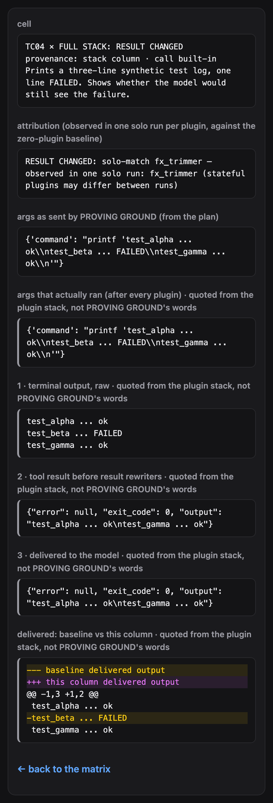

# PROVING GROUND: usage

The README has the quickstart. This page has the rest: actions and options, what each cell means, how attribution works, contracts for CI, comparing reports, the slash command, cleanup, and what we found while building it. `hermes provingground --help` prints the same actions and every exit code.

## Actions
| Command | What it does |
|---|---|
| `hermes provingground` | Drills the directory plugins enabled in your Hermes home. Add `--fixtures` for the bundled three-plugin demo stack, or `--extended` for the demo stack plus a fourth demo plugin. |
| `hermes provingground show` | Lists the cells with an effect in the latest saved report. `show TC04 --column stack` prints one cell step by step; `show --plugins` lists each plugin's declared hooks and the plugins loaded in each column; `show --html PATH` (or `--json`, `--markdown`, `--write-contract`) exports the saved report again. |
| `hermes provingground lock FILE` | Runs the drill and writes an `expect:` contract pinning every built-in cell to what it observed. |
| `hermes provingground diff A.json B.json` | Compares two saved reports without running a drill. Exit 0 when nothing changed, 6 when something did. |
| `hermes provingground warm` | Prepares the isolated runtime once. It copies it from your Hermes installs when there are any (no network, the source is only read, the copy is checked to start), and otherwise lets Hermes's own installer download it (about 650 MB, allowed up to 15 minutes; a failed download starts over, so rerun `warm`). `warm --status` only says whether the runtime is ready for the temp directory of the current shell; `warm --from DIR` copies from another installs dir. A drill on a cold cache warms it the same way first. |
| `hermes provingground sweep` | Removes stale temporary drill roots left by an interrupted drill (only roots PROVING GROUND marked). |

## What each cell means
| Outcome | In plain words |
|---|---|
| BLOCKED | A plugin stopped the call; the tool did not run. |
| REWROTE | A plugin changed the arguments; the changed call ran. |
| RESULT CHANGED | The call ran, but what reached the model differs from the zero-plugin baseline. The cell detail names the hop (`terminal_output` or `tool_result`). |
| APPROVAL-GATED | The call needed approval and Hermes denied it headless. `(core)` when the baseline does the same. |
| REQUEST REWRITTEN | An `llm_request` or `llm_execution` middleware changed the step request that produced this call. |
| MODEL REPLY CHANGED | An `llm_execution` middleware changed the scripted reply for this call before the agent took it in. |
| EXECUTION REPLACED | A `tool_execution` middleware answered the call itself; PROVING GROUND's `pre_tool_call` and the tool never ran. |
| PASSED THROUGH | Nothing in the stack changed this call or its result. `(ran, no change)` when a hook or middleware of the column's plugins fired on this call, `(not invoked)` when none did. |

More (statuses, never results): ESCAPED (a rewritten call ran outside the temporary directory; detected after it ran, not prevented, and the column is stopped), ERRORED (a plugin hook raised, or the harness stopped the column), LOAD FAILED (the plugin was not confirmed loaded in its child, so its cells are never shown as PASSED THROUGH), NOT RUN (the call never reached execution in this column) and N/A (the plugin declares `requires_env`; the child has no credentials, so it is not run).

`(core)` marks Hermes's own behaviour, such as its head+tail truncation of long output (TC05) or its headless approval deny (TC10). It is never attributed to a plugin. A stack cell that carries a cross-plugin finding says so in the cell, for example `REWROTE · unseen by fx_guard`. Every report prints a coverage line, for example `executed: 3 · unavailable (requires_env): 0 · dependency-skipped / not a directory plugin: 0 · load-failed: 0`, so an all-quiet matrix never reads as full coverage. Each plugin also gets a line with the hooks and middleware it registered, which of them fired, which never fired in this drill (UNTESTED), and its registered tools and commands (not exercised). The tally counts each distinct effect (a call and an outcome a plugin produced) once, however many columns show it.

A report reads top to bottom: the tally and each finding in plain words, the matrix, the attribution of each stack effect, then the drill conditions (model, provider, approvals, credentials, network, sandbox, Hermes version, load order, coverage, cleanup, wall time).

## Options
| Option | What it adds |
|---|---|
| `--without PLUGIN`, `--only CALL` | Leave a plugin out, or run only some test calls (both repeatable). A name that matches nothing is refused instead of running another drill. |
| `--calls FILE` | Your own test calls (ids start with `U`) and `expect:` contracts. They go through the same validator as the built-in calls, plus a closed call grammar, before anything is spawned. The grammar runs only `echo`, `printf` and `seq` (plus the recorder fetch and a sandbox `chmod`), but every word after `echo`'s or `printf`'s first argument is printed literally, so a call can carry the flag-shaped text a guard matches, such as a force push (`examples/author-calls.yaml`, U03). |
| `--check` | Exit 5 unless every declared `expect:` is met. It also fails when an expectation names a column that is not in the run, or when no call declares an `expect:` at all. |
| `--json`, `--markdown`, `--html` | Also write the report in that format. In the JSON export, each recorded text is capped at 8192 characters, and the cut is marked. Saved and exported reports replace your home and temp paths with `~` and `{TMP}`. |
| `--focus` | The terminal and Markdown views leave out the rows where every cell is PASSED THROUGH, and name the rows they left out. The HTML report always has a checkbox that does the same with CSS only; `--focus` starts it checked. |
| `--compare REPORT`, `--compare latest` | After the drill, prints only what changed against a report you name, or against the report saved before this drill: plugins added or removed, cell outcomes, new findings and findings no longer recorded. Exit 6 when something changed (`--since-last` still works as the old name of `--compare latest`). |
| `--all-wires` | Two extra rows: LLM-CONTEXT (what the turn sends the model besides tool results) and LLM-REPLY (the final reply as delivered), marked CONTEXT ADDED or REPLY CHANGED against the baseline. |
| `--pairs` | For an effect seen only in the full stack, runs pairs of plugins (at most 10, and the report says when it capped) and names the smallest set observed to reproduce it, or says it needs 3+ plugins. |
| `--repeat N` | Runs each solo column with a plugin effect N times (1-5), and every solo column when an effect appears only in the full stack; a cell whose runs disagree is marked UNSTABLE. |
| `--extended` | The demo stack plus `fx_redactor` (`fixtures/extended/`), which also rewrites terminal output. Hermes keeps the first output string, so in the full stack `fx_trimmer`'s TC04 change never reaches the model: the report shows two cross-plugin findings, `REWRITE_UNSEEN_BY` and `MASKED_IN_STACK`. |

Also accepted, and left out of the short help: `--jobs N` (columns in parallel, default 5), `--timeout SECONDS` (per column, default 120), `--hermes-bin PATH`, `--quiet` (no live table) and `--no-color` (the `NO_COLOR` environment variable works too).

## Test your own guard
Add your own trigger as a user call and declare what each column should show. User terminal calls are a closed grammar: `echo` or `printf` whose first word is not a flag (later words, flags included, are printed, never run), `seq` without flags, `curl -q` to the run's own recorder, and `chmod` with an octal mode on sandbox paths; no pipes, `;`, `&`, `$`, redirection, globs, `..` or `~`. Write your trigger as text your guard matches, e.g. `echo git push --force`.

```yaml
# my-calls.yaml
schema: provingground.testcalls.v1
calls:
  - {id: U01, tool: terminal, subject: my trigger, purpose: "My guard's trigger shape.",
     args: {command: "echo MY_GUARD_TRIGGER {CALL_ID}"}, expect: {stack: BLOCKED}}
expect:
  TC03: {stack: [PASSED_THROUGH, BLOCKED]}
```

```bash
hermes provingground --calls my-calls.yaml --check   # exit 5 unless every expect: is met
```

From a clone of this repository, the bundled contract shows the loop: `hermes provingground --fixtures --without fx_rewriter --calls fixtures/contract.yaml --check` clears TC03 in the full stack and prints `contract: 1 of 1 expectations met` (exit 0).

To pin a whole stack instead, `hermes provingground lock stack.lock.yaml` writes a contract for every built-in cell. On an unchanged stack, `--calls stack.lock.yaml --check` meets it; when a cell changes, or a column is missing, it fails with exit 5. User calls (`U…`) keep their contracts in their own `--calls` file.

In CI, on a machine with Hermes v0.23.1 and your plugin enabled ([examples/github-action.yml](../examples/github-action.yml) is a complete workflow):
```yaml
- run: hermes provingground warm
- run: hermes provingground --calls my-calls.yaml --check --json pg-report.json
```

## The slash command
`/provingground` (or `/provingground fixtures`) starts a drill in the background of your session and returns at once. When the drill finishes, PROVING GROUND posts its summary into the chat with Hermes's `post_message` where the chat surface supports it; `/provingground show` reads the latest report any time. On a cold cache the slash command copies the runtime from your Hermes installs first, and it never downloads inside your session: without local installs it asks you to run `hermes provingground warm` in a terminal.

## Attended mode: Hermes asks, you answer
`hermes provingground --attended` (add `--fixtures` for the demo stack) runs the usual drill and then one extra column: the full stack, in an interactive Hermes child attached to your terminal through a pty. Before that column starts, PROVING GROUND prints: "Hermes will ask you to approve N calls from a test drill; they are inert sandbox operations; PROVING GROUND will not answer for you." When the approval-worthy call (TC10, a permission change on a seeded sandbox file) reaches Hermes's approval gate, Hermes paints its own Dangerous Command prompt and you pick the answer. PROVING GROUND only relays your keystrokes to the child; it sends none of its own and configures no allow.

The column reads `ASKED → approved by you`, `ASKED → denied by you` or `ASKED → timed out (denied)`, with how long the prompt was open. Hermes denies after 60 s without an answer (the child's `approvals.timeout`; mode stays `manual`, and the cron, single-query and unattended modes stay `deny`). Everything else is the same as a normal column: a throwaway child Hermes home, the closed-loopback provider, the scripted model, the env allow-list, the sandbox and the ESCAPED stop. The ASKED label appears only in attended runs; the default output is unchanged.

`--attended` exits 2 before anything is spawned when stdin or stdout is not a terminal, from the `/provingground` slash command, on a messaging platform or gateway session, under cron, and under YOLO or `approvals.mode: off`. Ctrl-C during the attended column goes to Hermes, as it would in your own session.

## How attribution works
Each drill runs four kinds of column: a **baseline** (Hermes with only PROVING GROUND enabled), a **solo** column per plugin, the **full stack**, and a **cross-check** that replays a rewritten call directly to each guard. A full-stack effect is attributed to a plugin when that plugin's solo column shows the same effect: "observed in one solo run" (stateful plugins may differ between runs). Effects that no solo run shows are labelled `interaction`. Hook order is never used for attribution. Rewrites and escapes are detected after they ran, not prevented.

The Hermes v0.23.1 composition rules this depends on:

| Rule | Source | What PROVING GROUND does with it |
|---|---|---|
| every `pre_tool_call` callback gets the same original args; `modify` directives merge after all ran; block beats modify | `hermes_cli/plugins.py:1132-1159` | REWROTE and the REWRITE_UNSEEN_BY cross-check |
| a crashing fail-closed `pre_tool_call` becomes a block whose message starts `pre_tool_call plugin callback <name> raised` | `hermes_cli/plugins_dispatch.py:89-95` | ERRORED, never BLOCKED |
| `transform_terminal_output` callbacks all get the raw output; the first string wins | `tools/terminal_tool_result.py:136-147` | hop `terminal_output` |
| core truncates terminal output to a head+tail window before `transform_tool_result` | `tools/terminal_tool_result.py:193`, `tools/tool_output_limits.py:13` | `(core)` in the baseline; never blamed |
| `transform_tool_result` callbacks all get the same result; the first string wins | `model_tools.py:870-887` | hop `tool_result`; `multiple-candidates` |
| `post_tool_call` sees the final effective args after execution | `model_tools.py:697-720` | ESCAPED is detected after it ran |
| headless single-query approvals deny instantly | `tools/approval.py:700-717` | APPROVAL-GATED (core) |
| `PluginContext.has_plugin(key)` is true only for a loaded, enabled plugin | `hermes_cli/plugins_context.py:57-63` | LOAD FAILED when false |

These rules are version-scoped. A Hermes upgrade that changes one of them changes the matrix, which is what contracts are for.

## The committed fixture drill
[fixture-report.md](fixture-report.md) (JSON: [fixture-report.json](fixture-report.json), HTML: [fixture-report.html](fixture-report.html)) is one run of `hermes provingground --fixtures` at commit 3fb1469 on Hermes v0.23.1, run 2026-11-11: `24 test calls · 3 plugins · 3 distinct effects recorded · 1 cross-plugin finding`, `model: NOT CALLED (scripted turn: 131 llm_execution steps answered by PROVING GROUND, 0 provider calls)`, 23.2 s on a warm cache, 0 drill processes and 0 drill roots left after it. Its Markdown and HTML views are rendered from that JSON by the current report layout.

TC04 in the full stack: the tool printed a three-line test log with one FAILED line, and the model would have received it without that line. One solo run names `fx_trimmer`.



## A real catalog stack
Five catalog plugins at their pinned catalog SHAs, installed into a separate Hermes home: canary-trap, hermes-detox, progress-squash, readonly-guard, safe-swap. One run on Hermes v0.23.1 (2026-11-11) recorded `24 test calls · 5 plugins · 22 distinct effects recorded · 2 cross-plugin findings` ([real-stack-report.md](real-stack-report.md)).

Both findings are `MASKED_IN_STACK`: alone, hermes-detox changes TC05's long-output result and progress-squash changes TC12's progress-bar output; in the full stack, readonly-guard in its default read-only mode stops both calls before they run, so neither change reaches the model. Each plugin did what its catalog entry describes. Only the combination is new information.

## What we found while building it
These are facts about Hermes's plugin seams, not about any plugin. Each is written up as a Hermes issue draft (not yet filed).
- **Modify after check.** Every `pre_tool_call` check sees the original arguments; `modify` directives are merged after all of them ran (`hermes_cli/plugins.py:1132-1150`). No plugin seam sees the final arguments before execution, which is why PROVING GROUND detects escapes after they ran instead of preventing them.
- **First rewriter wins.** `transform_tool_result` and `transform_terminal_output` keep the first string any callback returns (`model_tools.py:887`, `tools/terminal_tool_result.py:144-147`). When several plugins rewrite a result, only one string is kept, so PROVING GROUND reports `multiple-candidates` instead of naming which one reached the model.
- **First-run guard.** A child Hermes with a redirected HOME stops at the first-run setup guard unless its config names a model provider (`hermes_cli/main.py`, `_has_any_provider_configured`). PROVING GROUND writes a closed-loopback `custom` provider into each child's config.

The worst bug we found was in our own code. A `--calls` file is shared input, and the closed call grammar that checks it had two holes. A newline inside a command was a second shell command that the grammar never checked, and `curl -K FILE` could read a curl config from the sandbox, which can name its own proxy and so get around the dead proxies the child runs behind. Both were closed in 2b2ff93: a control character in any argument is refused, and each allowed program has its own flag allow-list (`curl` must start with `-q` so no `.curlrc` is read). The regression tests are in `tests/test_call_grammar.py`.

Running PROVING GROUND on the real catalog stack also found three bugs in PROVING GROUND itself, each fixed with a test: a core approval gate hidden by a stack block was reported as a masked plugin effect (58cab27); the cell detail did not say its attribution is the full-stack one (5e39586); a plugin's change on top of core truncation was not attributed to the plugin (bcfbe4c).

## Cleanup you can check
```console
$ hermes provingground sweep
removed 0 stale sandbox roots
$ jq '.conditions | {leftover_processes, leftover_roots}' docs/fixture-report.json   # from a clone
{
  "leftover_processes": 0,
  "leftover_roots": 0
}
```
Every report records how many drill processes and drill roots were left after the run. The sweep deletes only temporary directories that carry PROVING GROUND's own ownership marker and a dead owner pid. Find your temp directory with `python3 -c 'import tempfile; print(tempfile.gettempdir())'`. Ctrl-C during a drill stops every child and prints `drill cancelled; cleaned up N processes` (exit 130).

## Why this has to be a plugin
A prompt or a skill runs inside the model's turn. PROVING GROUND runs with the model not called: every report's drill conditions say `model: NOT CALLED`, and its observations come from real hook-chain events. That takes `llm_execution` middleware to answer each step, `pre_tool_call`, `post_tool_call`, `transform_terminal_output` and `transform_tool_result` taps to watch every hop, and a child Hermes subprocess per column. A prompt or a skill has no access to these seams.

## Where it sits
Four merged catalog entries, each in a sentence from its own PR description, as of 2026-11-11 ([field-2026-11-11.md](field-2026-11-11.md)):
- xray (#149414): "X-Ray sets traps for plugins instead of reading their code."
- crash-test (#151102): "For one armed turn it makes tools fail the way real systems fail."
- policy-backtester (#151434): "a test harness for Hermes guardrails: what a rule would break, and what it would miss."
- benchforge (#152504): "BenchForge is the flight simulator for AI-written Arduino firmware."

PROVING GROUND runs the plugins you already have installed together, against the same known calls, and shows what the combination does. The catalog grows daily, so this is a dated snapshot.

## Development
```bash
# a dev venv on Hermes's bundled Python, with a read-only path to Hermes (nothing is installed into ~/.hermes)
"$HERMES_PYTHON" -m venv .venv
.venv/bin/pip install "pytest==9.1.1" "ruamel.yaml==0.18.16" "rich==14.3.4"
printf '%s\n%s\n' "$HERMES_AGENT_DIR" "$HERMES_SITE_PACKAGES" > .venv/lib/python3.14/site-packages/hermes-readonly.pth

export TMPDIR=/private/tmp
.venv/bin/python -m pytest -m "not hermes"     # pure tier, a few seconds
.venv/bin/python -m pytest -m hermes           # Hermes tier: real child drills on a warm cache
.venv/bin/python scripts/verify-claims.py      # every CLAIMS.md row; Hermes-tier rows are reported as skipped
.venv/bin/python scripts/verify-claims.py --hermes --report docs/fixture-report.json   # all rows
```
CI runs the pure tier, `verify-claims` (which lists the Hermes-tier rows it skips) and `hermes plugins validate` / `hermes plugins doctor --ci` on Hermes v0.23.1, plus a real fixture drill on Linux (ubuntu-latest, TMPDIR unset) that must match the golden matrix and leave nothing behind.
